# CareSync - AI-First Telehealth Platform (Backend)

> 🌐 **Live Web Application**: [https://caresync-vikrant.vercel.app/](https://caresync-vikrant.vercel.app/)


---

## 🧠 AI-First: AI in Every Journey

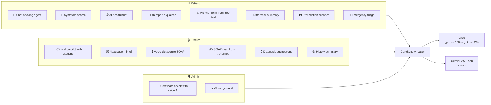

---

## 💬 How One AI Chat Message Flows

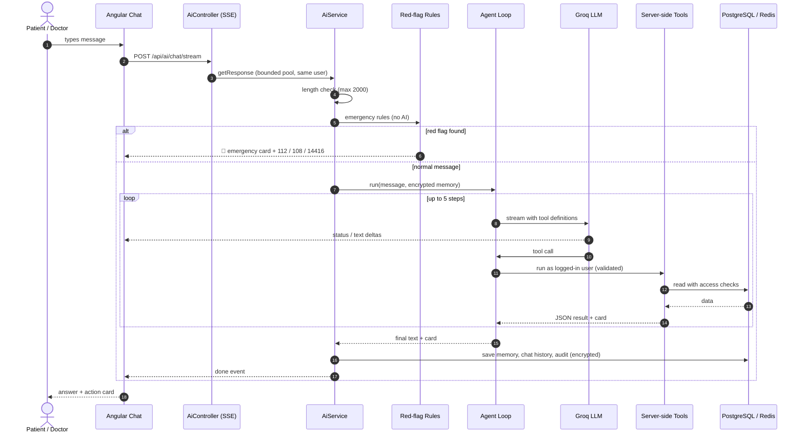

---

## 🔁 Agent Tool-Calling Loop

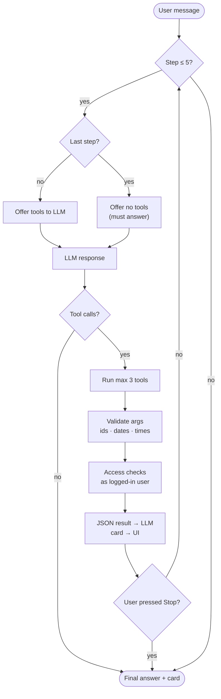

---

## 🧰 Tools the AI Can Use

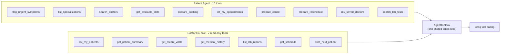

---

## ✅ Human-in-the-Loop: AI Prepares, User Confirms

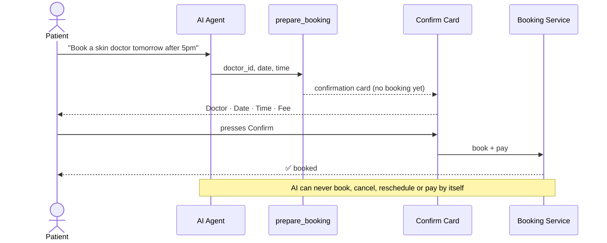

---

## 🚨 Two-Layer Emergency Triage

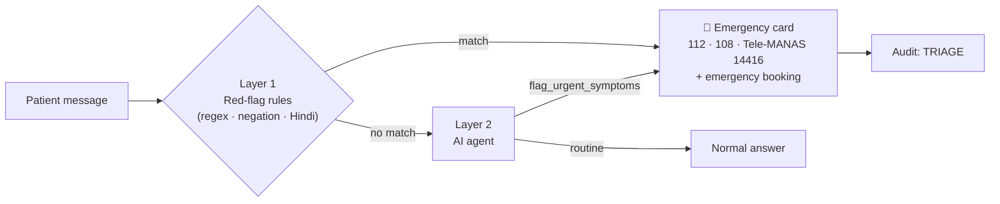

---

## 🩺 Doctor Co-pilot: Grounded, Cited, Access-Checked

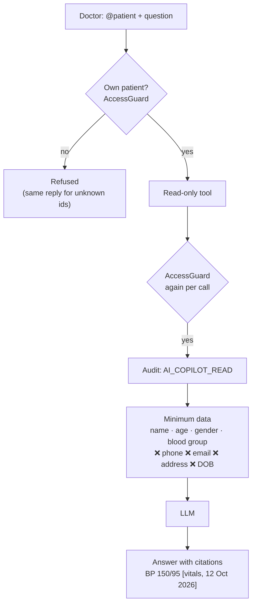

---

## ⚡ Proactive AI

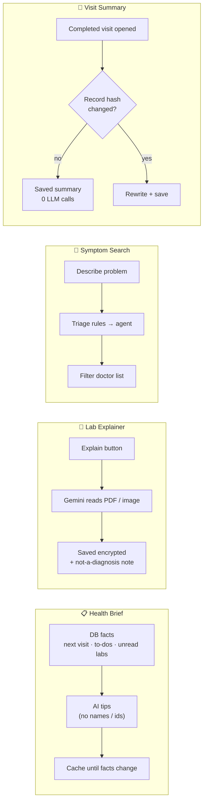

---

## 🔀 Model Routing & Fallback

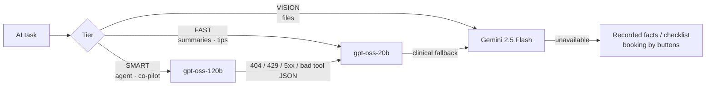

---

## 🛡️ AI Guardrails & Cost Control

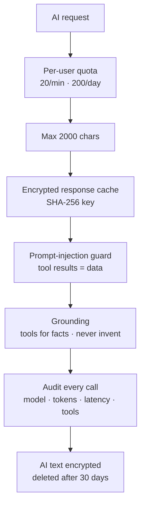

---

## 💾 AI Memory & Saved Chats

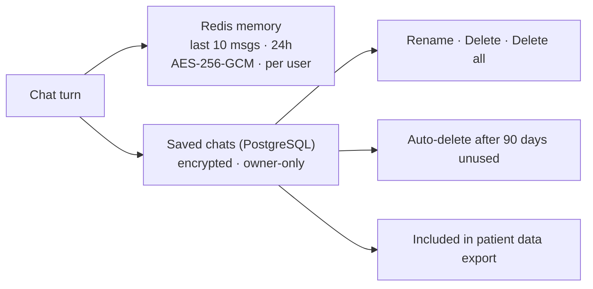

---

## 🏛️ System Architecture

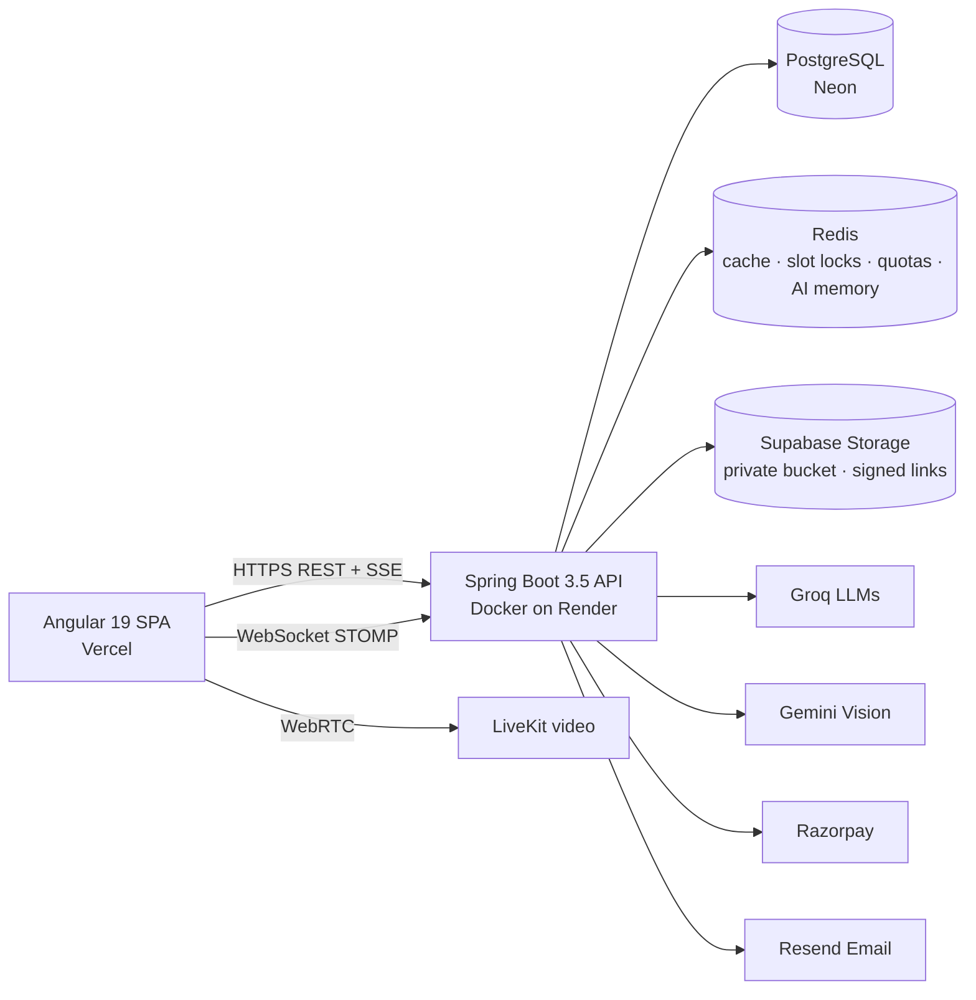

---

## 🔐 Data Protection Layers

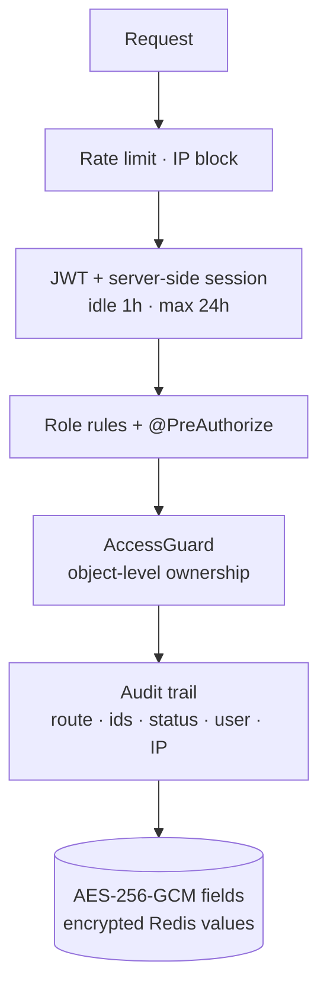

---

## 🔒 No Double Booking

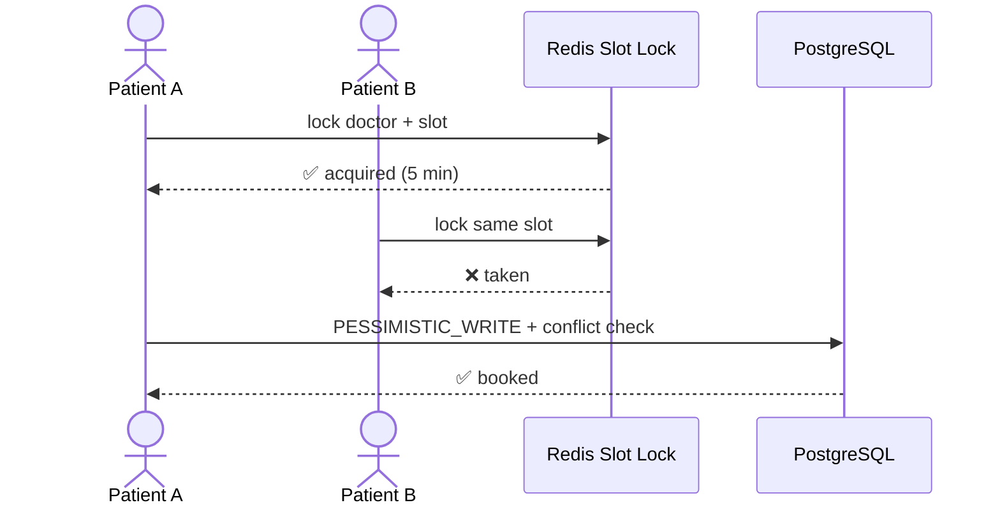

---

## 🛠️ Tech Stack

| Layer | Technology |
|---|---|
| Backend | Spring Boot 3.5 · Java 21 |
| Frontend | Angular 19 · Tailwind CSS |
| Database | PostgreSQL · Flyway (13 migrations) |
| Cache / Locks | Redis |
| AI | Groq gpt-oss-120b / 20b · Gemini 2.5 Flash |
| Real-time | SSE · WebSocket STOMP · LiveKit |
| Security | JWT + sessions · AES-256-GCM · RBAC · Audit |
| Payments | Razorpay |
| Deploy | Docker · Render · Neon · Vercel |

---

## 📖 Documentation & Links

- 🌐 **[Live Web Application](https://caresync-vikrant.vercel.app/)**
- 📐 **[System Architecture Deep-Dive](docs/architecture_overview.md)**
- 🧪 **[Java Concurrency Learning Lab](docs/java-concurrency-learning-lab.md)**
- 🗄️ **[Database ERD Diagram](https://dbdiagram.io/d/6970e7c2bd82f5fce22c9b1d)**
- 🌐 **[Live Swagger API UI](http://caresync-backend-aq8e.onrender.com/swagger-ui)**

---

## ⚡ Quick Start

```bash
# Clone the repository
git clone https://github.com/vikrant48/careSync.git
cd careSync

# Run backend locally
./mvnw spring-boot:run
```
